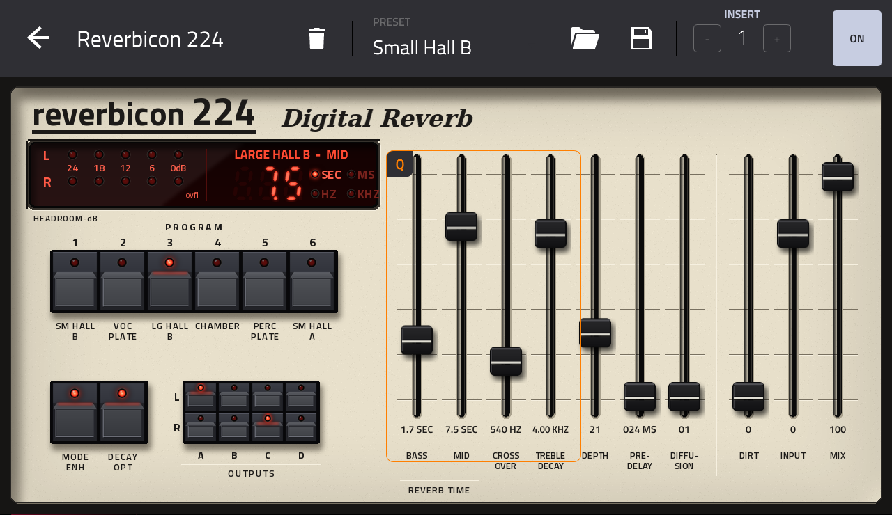

# Reverbicon 224



A Lexicon 224 (original, firmware v4.4) as a native effect plugin for Akai MPC OS standalone devices. It does not imitate the
224's sound: it runs the 224's **own firmware** on an emulated machine, the way the original hardware did:

- the 8080 control computer executing the v4.4 ROMs, with the front panel the firmware reads (program keys, sliders, SHIFT page);
- the DSP the firmware programs, row by row, with its arithmetic, delay memory and timing;
- the 12-bit gain-ranging converters and the input and output boards' analog filters.

So the six programs, the way the sliders behave, the values on the display, and the sound are the firmware's. The plugin works
the 224's front panel for you: picking a program presses its key, moving a slider moves the pot, and the firmware takes it.

What you get on the screen: the six program keys, the BASS / MID decay, CROSSOVER, TREBLE DECAY, DEPTH, PRE-DELAY and DIFFUSION
sliders, Mode Enhancement and Decay Optimization, the four output pairs, Dirt, Input and Mix, a live headroom meter, and the
224's red **LED readout**: the last slider you moved, as the firmware's display shows it ("2.6 SEC", "8.80 KHZ", "024 MS"). Sixteen
presets in MPC's PRESET menu; the Q-Links follow the sliders.

## You supply the ROMs

The plugin needs the original **Lexicon 224 v4.4 ROM1 to ROM5** (2048-byte EPROM images, one per chip). They are not included
and never will be: you need the originals from a 224 you own. Other firmware versions do not work.

Put the five files in the plugin folder's **`Content/ROMs/`** (see [Install](#install) for where the plugin folder is and how to
add them). The plugin recognises each chip by its checksum, so the file names do not matter. When it loads it
starts the firmware (under a second on a Live III); until then it passes the audio through.

| Display says | Meaning |
|---|---|
| `ADD ROMS TO CONTENT/ROMS (n/5)` | not all five chips are in the folder yet |
| `STARTING` | the firmware is booting |
| the program name | running |
| `ROMS NOT RECOGNISED` | five files, but the firmware did not come up (not the v4.4 chips) |

## Install
There are two plugin formats. Use one of them, not both: they are the same plugin.

| Plugin format | Zip | How it is installed | Plugin folder |
|---|---|---|---|
| **SDK format** (MPC OS 3.10.1 or later) | `Reverbicon-224-<version>-mpc-sdk.zip` | By hand: unzip it, copy the folder `sd88me - VST - Reverbicon 224` into `VST2 Plugins` at the root of a drive the MPC can see, turn on **Preferences > Enhancements (Beta) > Enable Enhancements** and **External Plugin Support**, and restart the MPC | `VST2 Plugins/sd88me - VST - Reverbicon 224/` on that drive |
| **Older format** (plugins listed in `MPC.settings`) | `Reverbicon-224-<version>-mpc-aarch64.zip` (Live III and other 64-bit MPCs) or `-mpc-armv7.zip` (Force and other 32-bit MPCs) | With the **OpenMPC Plugin Manager**, or by hand over SSH with the zip's `install.sh` (needs root access; on a Live III add `-t /nvme/Synths`) | `sd88me - VST - Reverbicon 224/` in the Synths folder it was installed to |

The zips are on [Releases](https://github.com/sd88me/mpc-vst-reverbicon224/releases).

### Adding the ROMs
The five files go in the plugin folder's `Content/ROMs/`, for example `VST2 Plugins/sd88me - VST - Reverbicon 224/Content/ROMs/`.

| Plugin format | How to add the ROMs |
|---|---|
| SDK format | By hand: over USB, or with the MPC's file browser. |
| Older format, with the OpenMPC Plugin Manager | Use its **Your ROMs and files** step: it checks each file and copies it into `Content/ROMs/`. Or copy them by hand. |
| Older format, with `install.sh` | By hand: with `scp`, over USB, or with the MPC's file browser. |

### Upgrading
- **SDK format:** copy the new folder over the old one (merge it, don't delete the old folder first) so `Content/ROMs/` stays.
- **Older format:** the OpenMPC Plugin Manager and `install.sh` upgrade in place and keep `Content/ROMs/`.

## Controls

| Control | What it is |
|---|---|
| PROGRAM 1-6 | Small Hall B, Vocal Plate, Large Hall B, Acoustic Chamber, Percussion Plate A, Small Hall A. A change mutes the reverb for about 50 ms while the firmware loads the program into the DSP, as on the hardware. |
| BASS, MID | reverb time below and above the crossover, 0.6 to 70 seconds |
| CROSSOVER | 100 Hz to 10.9 kHz |
| TREBLE DECAY | the high-frequency rolloff, 100 Hz to 10.9 kHz |
| DEPTH | 00 to 71 |
| PRE-DELAY | covers the loaded program's whole range, as the 224's slider does: halls 24-152 ms, plates 0-107 ms, Acoustic Chamber 25-255 ms |
| DIFFUSION | 01 to 63 (the 224's SHIFT page) |
| MODE ENH, DECAY OPT | Mode Enhancement and Decay Optimization (the 224's PROG 7 and 8) |
| OUTPUTS | which two of the 224's four outputs (A-D) you hear on the left and the right |
| DIRT | our own addition, not from the 224: converter hiss, small gain-range mismatches, a soft input limit. Off at 0. |
| INPUT, MIX | the level into the 224 (dB) and dry/wet |

Slider readouts show what the firmware stored and displays, so they move in the 224's own steps.

## Devices

| Device | Status |
|---|---|
| MPC Live III (aarch64) | tested: about 18% of one core (p99 23%, worst block 34% of a 128-frame block at 44.1 kHz) |
| Force and 32-bit MPCs (armv7) | built and checked offline (output identical to the 64-bit build), **not yet tried on a device**. Expect roughly half a core: one instance. |

## Build

Needs Docker, Python 3 with Pillow, and a checkout of [mpc-vst-plugins](https://github.com/sd88me/mpc-vst-plugins) next to this one
(or `MPC_VST=/path`).

```
python3 vst/art/make_art.py     # skin artwork (all drawn in code)
vst/build.sh                    # skin, reverbicon224.so (armv7) and build/aarch64/reverbicon224.so
python3 tools/package_vst2.py   # dist/<vendor> - VST - Reverbicon 224/ (MPC OS 3.10.1 VST2 Plugins folder)
```

Tests (the emulator's are checked against reflecticon-224; the ones marked ROMs need yours):

```
<mpc-vst-plugins>/tools/test_port.sh vst/vst.json [aarch64]  # host test of the plugin (ASan)
test/dsp224_compare.cpp       # our DSP against reflecticon's, bit-exact
test/i8080_lockstep.cpp       # our 8080 against reflecticon's, instruction by instruction (ROMs)
test/machine224_portdiff.cpp  # the whole machine's port traffic against reflecticon's host (ROMs)
test/analog224_compare.cpp    # the analog boards against reflecticon's chains
test/panel224_test.cpp        # the front panel: programs, sliders, DIFFUSION, toggles (ROMs)
test/render_test.c            # every program through the plugin, CPU per block (ROMs)
test/slider_sweep.cpp, test/display_sweep.cpp   # regenerate src/slider_tables224.hpp from the firmware (ROMs)
```

## How it works

| File | |
|---|---|
| `src/i8080.hpp` | the 8080 |
| `src/dsp224.hpp` | the DSP: the 224's microinstructions decoded once, rows run from a table |
| `src/machine224.hpp` | the control computer: memory map, the DSP's ports and control store, the front panel's 8255, wait states |
| `src/analog224.hpp` | input and output boards (exact modal integration of reflecticon's pole/residue chains), converters, the Dirt layer |
| `src/reverb224.hpp` | host audio in and out at any rate, each input sampled at its converter's instant |
| `src/panel224.hpp` | the front-panel operator: key presses and slider moves the way a hand makes them |
| `src/engine.cpp` | the plugin: ROM loading, the boot thread, parameters, display |

`docs/ENGINE-PLAN.md` has the design and the measurements behind it.

## Credits and licence

- [**reflecticon-224**](https://github.com/joelanders/reflecticon-224) by Joe Landers: the reference this emulator is built and
  tested against, the front-panel recipe and RAM layout, the display decoding, and the analog boards' filter data and peripheral
  models (`src/third_party/reflecticon/`, unchanged). AGPL-3.0.
- **Titillium Web** fonts in `vst/art/fonts/`: SIL Open Font License (`OFL.txt`).
- Lexicon and 224 are named only to say what is emulated; this project is not affiliated with or endorsed by Lexicon.

Reverbicon 224 is licensed under the **GNU Affero General Public License v3.0** (`LICENSE`).
