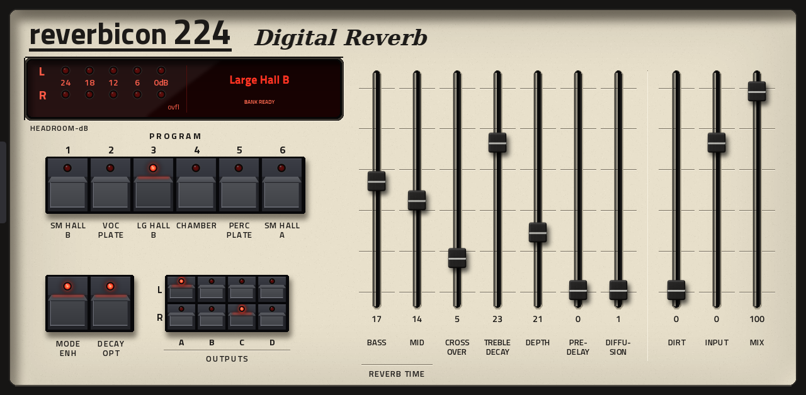

# Reverbicon 224



A Lexicon 224 (original, firmware v4.4) style reverb as a native effect plugin for Akai MPC OS standalone devices: Force and
MPC Live / One / X / Key (armv7), and MPC Live III (aarch64). It has the six original programs, the 224's bass, mid, crossover,
treble decay, depth, pre-delay and diffusion controls, Dirt, Input and Mix faders, Mode Enhancement, Decay Optimisation and the
four output pairs. The touch skin is drawn after the original remote: program keys with LEDs, a red LED display, a live headroom
meter, black-capped faders. Sixteen presets show in MPC's PRESET menu, and the Q-Links follow the faders.

The engine is [cineolX](https://github.com/temaniak/cineolX)'s native 224 core (itself validated against
[Reflexion](https://github.com/joelanders/reflexion-224)); this repo is the MPC plugin around it.

## You supply the ROMs

The plugin needs the original **Lexicon 224 v4.4 ROM1 to ROM5** (2048-byte EPROM images, one per chip). They are not included
and never will be: you need the originals from a 224 you own. Other firmware versions do not work.

Put the five files in the plugin's **`Content/ROMs/`** folder. The next time the plugin loads it builds its program bank **by
itself, in the background** (a helper program, `bankhelper-<arch>`, starts with the plugin and runs at low priority), and the
display shows what it is doing. You do not have to restart anything: the plugin loads the bank the moment it is ready.

| Display says | Meaning |
|---|---|
| `ADD ROMS TO CONTENT/ROMS (n/5)` | not enough 2048-byte files in the folder yet |
| `BUILDING BANK n%` | the helper is working; the plugin passes audio through unchanged meanwhile |
| `BANK READY` | done; the bank is saved as `Content/programs-v44.bank224` and later loads are instant |
| `NEED ALL FIVE V4.4 ROMS (ROM1-5)` | the files are not the five v4.4 chips (a wrong version, or a duplicate) |
| `BANK HELPER MISSING` | `Content/bankhelper-<arch>` is not there or not executable |

How long the first build takes (measured, with the device otherwise idle and MPC playing normally):

| Device | Time |
|---|---|
| MPC Live III | about 5.6 minutes (337 s) |
| Force | about 17 minutes (1020 s) |

The touch screen stays responsive while it runs. Several plugin instances share one build (a lock keeps a second helper from
starting). A bank built on one device is byte-identical to one built on a PC or another device, so you may also copy
`programs-v44.bank224` between machines. Delete it to rebuild.

### With the desktop installer

The desktop installer's **Your ROMs and files** step ([mpc-vst-plugins](https://github.com/sd88me/mpc-vst-plugins) PR #668,
`user_files` in the plugin manifest) reads `release/user-files.json` from this repo. You pick your ROM files on the computer, it
checks each one (right size and start, "ROM3 (Lexicon 224 v4.4): looks right"), and copies the good ones into
`Content/ROMs/` on the device. It cannot confirm the exact v4.4 chip (the plugin does that when it builds the bank, and says so on
its display). `release/user-files.json` is given to `release.py` with `--user-data Content/ROMs --user-files
release/user-files.json`; `test/user_files_check.py` checks it against your ROMs.

## Build

Needs Docker, Python 3 with Pillow, and a checkout of
[mpc-vst-plugins](https://github.com/sd88me/mpc-vst-plugins) next to this one (or `MPC_VST=/path`).

```
tools/fetch_cineolx.sh          # cineolX core + artwork at a pinned commit (not redistributed here)
tools/build_helpers.sh          # bankhelper-x86_64 / -armv7 / -aarch64
python3 vst/art/make_art.py     # skin artwork
vst/build.sh                    # skin, reverbicon224.so (armv7) and build/aarch64/reverbicon224.so, plugin-list entry
```

Tests (none need a device except the bench):

```
<mpc-vst-plugins>/tools/test_port.sh vst/vst.json            # x86 host test (ASan), also `... aarch64`
test/import_test.cpp                                          # the whole ROM-import flow against the x86 helper; needs your ROMs, ~3 min
test/user_files_check.py "<folder with your ROM1-5>"          # the installer's ROM rules
<mpc-vst-plugins>/tools/bench.sh <so> <device-ip>             # CPU on a device (put the bank in /tmp/Content first)
```

## Install by hand (Force, MPC 3.x)

1. Copy `vst/build/skin/sd88me - VST - Reverbicon 224/` to `/sdcard/Synths/` on the device. Put the matching
   `reverbicon224.so` in that folder (armv7 for the Force and Gen 1; `build/aarch64/` for a Live III), the `bankhelper-<arch>`
   file in its `Content/` folder (executable), and your ROMs in `Content/ROMs/`.
2. With MPC stopped, add `vst/build/pluginlist-entry.xml` to the `pluginList-arm` list in `MPC.settings` and start MPC again.
   Edit it as whole XML elements and keep the line endings: a broken list stops MPC from starting.

Updating later: replace only the skin, the `.so` and the helper; **keep `Content/`** (your ROMs and the built bank). A changed
skin only loads after MPC restarts.

## Measured

| Device | Mean | p99 | Worst block |
|---|---|---|---|
| MPC Live III (aarch64) | 5.1% | 5.3% | 32% (first block) |
| Force (armv7) | 14.5% | 19.4% | 23% |

(% of one 128-frame block at 44.1 kHz; `tools/bench.sh` of mpc-vst-plugins.) The Force figure suits one or two instances.

## Status

Working on both devices: loading, sound, skin, presets, Q-Links, project reload, ROM import (both devices, bank identical), headroom
meter. Not done yet: the 22 224XL programs; a crossfade when switching programs (they cut the old tail); a bit-exact comparison of
the ARM output against x86. `docs/HANDOFF.md` has the open items and what a public release still needs.

## Third-party material (not included)

- **cineolX** (the engine and artwork) and **Reflexion** (its reference emulator) have no licence yet. `tools/fetch_cineolx.sh`
  downloads them for your own build; nothing from them is committed here. Ask their authors before redistributing a build.
- **Titillium Web** fonts in `vst/art/fonts/` are under the SIL Open Font License (`OFL.txt`).
- Lexicon and 224 are names used only to say what is emulated; this is not affiliated with or endorsed by Lexicon.

The files in this repository are MIT licensed (`LICENSE`).
